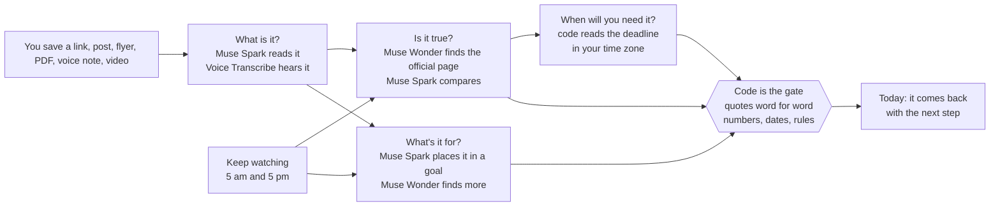

# Homing

[](https://github.com/Isreal-Oparanti/Homing/actions/workflows/ci.yml) [](LICENSE)

**Homing** (like a homing pigeon): wherever you let it go, it finds its way back. Your saves should too.

**A memory for everything you save: it reads it, proves it against the source, and brings it back the moment it matters.**

Built for the **Meta Global AI Developer Hackathon · Indie track**. Every model call runs on Meta's models (**Muse Spark**, **Muse Wonder**, **Muse Voice Transcribe**) through one gateway, `server/app/llm/gateway.py`. No other model provider, ever.

**Live:** https://homing-rho.vercel.app (press **Try the demo**) · **Video:** https://youtu.be/n3XILic3pms

## Why

Everyone saves things "for later". Then later never comes.

- **People save out of fear of losing things, and the pile becomes stress.** Tab and link hoarders keep items "just in case", and the build-up weighs on them (Chang et al., CHI 2021 [1]).
- **Organising doesn't bring things back.** People who carefully file into folders find things no faster than people who don't (Whittaker et al., CHI 2011 [2]).
- **A save only frees your mind if you trust it will be there.** When people believe their saved information is safe, they remember new things better; when they don't, they can't let go (Storm & Stone, Psychological Science 2015 [3]).
- **An unfinished goal keeps nagging until it has a plan.** Making a specific plan for it is what quiets it (Masicampo & Baumeister, JPSP 2011 [4]).
- **Read-later apps die when "later" never comes.** Pocket, the best known, shut down on 8 July 2025 [5].
- **People want AI to do the repetitive work, but stay in charge.** Workers want agents to take over about 46% of tasks, and most prefer a partnership to full automation (Shao et al., Stanford 2025 [6]).

And when a save does come back, it's often wrong. A real one: a blog post said the UNDP Young Africa Innovates programme was *"for young Nigerian innovators"*. The official page says applicants *"must be resident in one of the seven Cohort 2 states"*. The post left out the one rule that decides if you can apply.

Homing started from a real pile: **624 saves** in one "note to self" WhatsApp chat.

Homing's answer, in one line:

> **A save should come back on its own, at the moment it matters, saying only what its source can prove.**

In full: every save gets four answers, each from its own agent (*What is it? Is it true? What's it for? When will you need it?*). Models read, search and reason; code checks every quote, number, date and rule before you see it. Then the agents keep working without being asked: they check the source, find more for your goals, watch for changes, and prepare you for what's coming. Every run remembers what the last one learned.

Reading links with a model exists. Reminders exist. Web search exists. **We don't claim the parts. We claim the loop:** agents that act on your saves on their own, with code as the gate on every word, and memory that makes each run smarter than the last.

## How it works



The load-bearing mechanisms:

- **Code is the gate.** A quote is kept only if code finds it word for word in the source. A number, only if its quote states it. Dates are read by code, never by a model, in your time zone ("open 1 September to 18 November 2026" closes on 18 November). Who can apply is judged by code against what you told Homing; your profile is never sent to a model.
- **Muse Wonder works as an agent, three times.** In **Ask** it searches your saves and answers. In **Is it true?** it follows a blog or a post to the organisation's own page. In **What's it for?** it searches the web for more for your goals. Each time it chooses its own steps, and each time code refuses what it can't prove, says why, and sends it back.
- **It plans, and it learns.** Finding more starts with a plan you can read. Each goal keeps a memory: the searches it ran and what they gave, the sites refused and why, what you kept, what you said wasn't for you, and the lesson Wonder wrote at the end of the run. The next run starts from it.
- **The context stays sharp.** Wonder can only name refs (W1, L12), never type a URL, so words on a page can't send it anywhere. Code ranks a page's links before Wonder sees them, and pages it has read shrink in its context; code always checks against the full page.
- **It acts on its own.** Keep watching runs at 5 am and 5 pm. It re-reads official pages that can still change. An unchanged page costs no model call. A changed one is checked again, and you're told exactly what changed: "the deadline moved from 12 Nov to 15 Nov".
- **It prepares you.** Type what's coming up ("recording my demo video tomorrow evening"). Homing goes through the videos you saved for that goal and writes a prep sheet; every tip plays its video from the second it's said, checked against the captions.

## Results (live, Meta's models, 4 Nov 2026)

Every number comes from the committed scripts ([`server/evals/run.py`](server/evals/run.py)) or the stored record of real runs. Full report: [`server/evals/REPORT.md`](server/evals/REPORT.md).

**What the models proposed, and what code let through**

| Where | Proposed by the model | Kept by code | Refused or dropped |
|---|---|---|---|
| Ask: quotes in answers | 68 | **68** | 0 |
| Prep sheets: video points at a stated second | 45 | **44** | 1 not in the captions at that second |
| Finding more on the web (live runs) | 17 | **2** | 14 refused (closed, last year's, a list, not the official site), 1 not for the person |

The gate is strict on purpose: a run that keeps nothing beats one that shows you a call that already closed.

**The finds gate on 12 real pages: 12 of 12 right**

Twelve real pages, recorded on 4 Nov ([`evals/finds_pages.jsonl`](server/evals/finds_pages.jsonl)), each labelled by hand. Code only, no model.

| Trap | Example | Code |
|---|---|---|
| An opportunity blog, not the organisation | opportunitiesforafricans.com | refused |
| "Our 2026 submissions are now closed!" | socialshifters.co | refused |
| Last year's programme ("April to June 2026") | startup.google.com | refused |
| A list of 14 calls | menterprise.africa | refused |
| No sign a call is open now | acceler8.africa, africabusinessheroes.org, and 4 more | refused |
| Really open | ycombinator.com, anzisha.org, onevectasummit.com | **kept** |

**A real run, step by step** (saving the UNDP blog post on the live demo):

| Time | Agent | Step |
|---|---|---|
| 17:14 | Is it true? · Muse Wonder | Opened the blog, then youngafricainnovates.ng |
| 17:14 | Is it true? · Muse Wonder | Searched the web for "site:undp.org Nigeria Young Africa Innovates Programme Cohort 2" |
| 17:14 | Is it true? · **Code** | **Refused that source: those words aren't on the page word for word** |
| 17:14 | Is it true? · Muse Wonder | Chose youngafricainnovates.ng as the source |
| 17:16 | Is it true? · Muse Wonder + Spark | 3 things the post left out. 1 question: "resident in Abia, Akwa Ibom, Cross River, Katsina, Niger, Plateau or Taraba?" |
| 17:16 | When will you need it? · **Code** | Brings it back on Wed 11 Nov, from "open 1 September to 18 November 2026" |

**It learns** (two runs of Find more on the same goal):
- **Run 1, 17:37:** "Next time: Avoid 500 Sustainable Innovation (closed Sep 2025) and Google South Africa (not eligible for this person)."
- **Run 2, 17:40:** "Plan: … Ruling out: … 500 Sustainable Innovation (closed Sep 2025), Madica (no open date), Google South Africa (not eligible)."

**More checks**

| Check | Result |
|---|---|
| Dates read by code (real and post-style phrases, worked out by hand) | **30 of 30** |
| Search by meaning on the real pile | 12 of 15 questions with a right save in the top 5 |
| A page telling the agent to open another site | can't happen: there's no ref to it (test) |

## What it costs (tokens, from the gateway's counters)

| Job | Per run, about |
|---|---|
| Read a save (Muse Spark) | 2,600 |
| Ask, as an agent (Muse Wonder) | 30,000 |
| Find the official source (Muse Wonder) | 13,000 |
| Find more for a goal (Muse Wonder, plus Spark to read who can apply) | 190,000 |
| Keep watching an unchanged page | **0** (code only) |
| Organise a whole pile into goals (one long-context pass) | 42,560 for 340 of 405 saves, against about 900,000 one at a time |

## Status and test results (4 Nov 2026)

- **251 tests pass** (`pytest`), plus lint, types and the web production build, on every push in CI.
- Live at https://homing-rho.vercel.app, agents running around the clock.
- Every screen in the video is the live product.

## Quickstart

```bash
# server (Postgres with pgvector: docker compose up -d db)
cd server
python -m pip install uv
cp .env.example .env            # set META_API_KEY
python -m uv sync
python -m uv run alembic upgrade head
python -m uv run uvicorn app.main:app --reload
python -m uv run python -m app.worker      # the agents
python -m uv run pytest                    # the tests
python -m uv run python -m evals.run       # the eval report

# web
cd web
npm install
cp .env.example .env.local
npm run dev
```

More: [server/README.md](server/README.md) · [docs/](docs/README.md)

## Try the demo (two minutes)

1. Open https://homing-rho.vercel.app and press **Try the demo**.
2. Go to **Agents**, press **Add**, and paste `https://www.opportunitiesforafricans.com/the-undp-africa-young-innovates-programme-2026-2027-for-young-nigerian-innovators/`. Watch the steps arrive.
3. About two minutes later, open the save: what the post left out, quoted from the official page; the one question; the deadline.
4. On **Today**, type *recording my demo video tomorrow evening*. Open the **Get ready** card and tap a chip: the video plays from that second.
5. In **Threads**, open a goal and press **Find more**. Watch the plan, the pages, and what code throws out.
6. In **Ask**, try *How do I get better at speaking on camera?*

## References

1. Chang, J. C., Hahn, N., Kim, Y., Coupland, J., Breneisen, B., Kim, H. S., Hwong, J., & Kittur, A. (2021). *When the Tab Comes Due: Challenges in the Cost Structure of Browser Tab Usage.* CHI 2021.
2. Whittaker, S., Matthews, T., Cerruti, J., Badenes, H., & Tang, J. (2011). *Am I wasting my time organizing email? A study of email refinding.* CHI 2011.
3. Storm, B. C., & Stone, S. M. (2015). *Saving-enhanced memory: The benefits of saving on the learning and remembering of new information.* Psychological Science, 26(2).
4. Masicampo, E. J., & Baumeister, R. F. (2011). *Consider it done! Plan making can eliminate the cognitive effects of unfulfilled goals.* Journal of Personality and Social Psychology, 101(4).
5. Mozilla (2025). *Pocket is shutting down* (announcement; service ended 8 July 2025).
6. Shao, Y., et al. (2025). *Future of Work with AI Agents: Auditing Automation and Augmentation Potential across the U.S. Workforce* (WORKBank). Stanford University.

MIT licensed. See [LICENSE](LICENSE).
