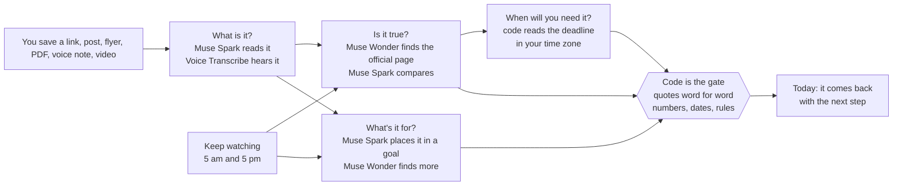

# Homing

[](https://github.com/Isreal-Oparanti/Homing/actions/workflows/ci.yml) [](LICENSE)

**Homing** (like a homing pigeon): everything you save finds its way back to you, at the moment it matters, with proof.

**You saved it because it mattered. Homing makes sure it comes back.**

Built for the **Meta Global AI Developer Hackathon · Indie track**. Every model call runs on Meta's models: **Muse Spark**, **Muse Wonder** and **Muse Voice Transcribe**, through one gateway (`server/app/llm/gateway.py`) that names the model behind every step.

- **Live:** https://homing-rho.vercel.app. Press **Try the demo** (a full pile, shared with other visitors) or sign in with Google (your own, empty and private).
- **Video (3 min):** _link added at submission_

## Why

Everyone saves things "for later". A video that could change how you speak. A scholarship. A book someone swore by. A trick to try tomorrow. Then later never comes. The day you need it (the interview, the pitch, the deadline), it's buried somewhere you'll never scroll back to. The person who built this has 624 of them in a WhatsApp chat to himself.

And when a save does come back, it's often wrong. A real example from building this: a blog post said the UNDP Young Africa Innovates programme was *"for young Nigerian innovators"*. The official page says applicants *"must be resident in one of the seven Cohort 2 states"*. The post left out the one rule that decides whether you can apply.

So the hard part isn't saving. It's two things: **bringing it back at the right moment**, and **only with what can be proven.**

## In one line

> **A save should come back on its own, when it matters, saying only what its source can prove.**

Every save gets four answers, each from its own agent: *What is it? Is it true? What's it for? When will you need it?* Models read, search and reason. Code checks every quote, number, date and rule before you see it.

Reading links with a model exists. Reminders exist. Web search exists. We don't claim the parts. **We claim the loop:** agents that act on your saves without being asked (they check the source, find more for your goals, keep watching for changes, and prepare you for what's coming), with code as the gate on every word, and memory that makes each run smarter than the last.

## How it works



The mechanisms that carry the weight:

- **Code is the gate.** A quote is kept only if code finds it word for word in the source. A number only if its quote states it. Dates are read by code, never by a model, in your time zone ("open 1 September to 18 November 2026" closes on 18 November). Who can apply is judged by code against what you told Homing; your profile is never sent to a model.
- **Muse Wonder works as an agent, three times.** In **Ask** it searches your saves and answers. In **Is it true?** it follows a blog or post to the organisation's own page. In **What's it for?** it searches the web for more for your goals. Each time it chooses its own steps, and each time code refuses what it can't prove and tells it why. Wonder fixes it or moves on.
- **It plans, and it learns.** Finding more always starts with a plan you can read. Each goal keeps a memory: the searches it ran and what they gave, the sites refused and why, what you kept, what you said wasn't for you (with a one-tap reason), and the lesson Wonder wrote at the end of the run. The next run starts from that memory.
- **The context stays sharp.** Wonder can only name refs (W1, L12), never type a URL, so words on a page can't send it anywhere. Code ranks a page's links before Wonder sees them (links to other sites and about applying first; menus, footers and social links dropped). Pages it has read shrink in its context; code always checks against the full page.
- **It acts on its own.** Keep watching runs at 5 am and 5 pm (Lagos time). It re-reads official pages that can still change. An unchanged page costs no model call. A changed one is checked again, and you're told exactly what changed: "the deadline moved from 12 Nov to 15 Nov", "it's now closed".
- **It prepares you.** Type something coming up ("recording my demo video tomorrow evening"). Homing goes through the videos you saved for that goal and writes a prep sheet. Every tip plays its video from the second it's said, checked against the captions.

Details: [docs/03-agents.md](docs/03-agents.md) · verification: [docs/05-verification.md](docs/05-verification.md)

## A real run, step by step

Saving `opportunitiesforafricans.com/the-undp-africa-young-innovates-programme…` on the live demo, 4 Nov, from the Agents feed:

| Time | Agent | Step |
|---|---|---|
| 17:14 | Is it true? · Muse Wonder | Opened opportunitiesforafricans.com (the blog) |
| 17:14 | Is it true? · Muse Wonder | Opened youngafricainnovates.ng |
| 17:14 | Is it true? · Muse Wonder | Searched the web for "site:undp.org Nigeria Young Africa Innovates Programme Cohort 2" |
| 17:14 | Is it true? · **Code** | **Homing refused that source: those words aren't on the youngafricainnovates.ng page word for word** |
| 17:14 | Is it true? · Muse Wonder | Chose youngafricainnovates.ng as the source to check against |
| 17:16 | Is it true? · Muse Wonder + Spark | Checked against youngafricainnovates.ng: 3 things the post left out. 1 question to see if it fits you |
| 17:16 | When will you need it? · **Code** | Will bring this back on Wed 11 Nov, from "open 1 September to 18 November 2026" |

The card then asks one thing, and remembers the answer: *"Does this describe you: resident in Abia, Akwa Ibom, Cross River, Katsina, Niger, Plateau or Taraba?"*

And the learning, from two runs of Find more on the same goal:
- **Run 1, 17:37.** "Next time: Avoid 500 Sustainable Innovation (closed Sep 2025) and Google South Africa (not eligible for this person)."
- **Run 2, 17:40.** "Plan: … Ruling out: … 500 Sustainable Innovation (closed Sep 2025), Madica (no open date), Google South Africa (not eligible)."

## Results

Every number comes from the committed scripts ([`server/evals/run.py`](server/evals/run.py)) or the stored record of real runs. Full report: [server/evals/REPORT.md](server/evals/REPORT.md).

**What the models proposed, and what code let through**

| Where | Proposed by the model | Kept by code | Refused or dropped |
|---|---|---|---|
| Ask: quotes in answers | 68 | **68** | 0 |
| Prep sheets: video points at a stated second | 45 | **44** | 1 not in the captions at that second |
| Finding more on the web (stored record of live runs) | 17 | **2** | 14 refused (closed, last year's, a list, not the official site), 1 not for the person |

The gate is strict on purpose. A run that keeps nothing is better than one that shows you a call that already closed.

**The finds gate on real pages: 12 of 12 right**

Twelve real pages, recorded on 4 Nov ([`evals/finds_pages.jsonl`](server/evals/finds_pages.jsonl)), each labelled by hand. Code only, no model.

| Trap | Example | Code |
|---|---|---|
| An opportunity blog, not the organisation | opportunitiesforafricans.com | refused |
| "Our 2026 submissions are now closed!" | socialshifters.co | refused |
| Last year's programme ("April to June 2026") | startup.google.com | refused |
| A list of 14 calls | menterprise.africa | refused |
| No sign a call is open now | acceler8.africa, africabusinessheroes.org, and 4 more | refused |
| Really open | ycombinator.com, anzisha.org, onevectasummit.com | **kept** |

Building this eval caught three gaps before anyone else could: the "submissions are now closed" wording, last year's programme, and the list page. The live demo caught two more: a deadline window read from its start, and a rule about states judged as met from the country. All five are fixed, with tests.

**More checks**

| Check | Result |
|---|---|
| Dates read by code (real and post-style phrases, answers worked out by hand) | **30 of 30** |
| Search by meaning on the real pile (labels are drafts) | 12 of 15 questions with a right save in the top 5 |
| Prompt injection: a page telling the agent to open another site | the agent can't: there's no ref to it (test) |

**What it costs** (tokens, from the gateway's counters; Meta hasn't published Muse prices)

| Job | Per run, about |
|---|---|
| Read a save (Muse Spark) | 2,600 tokens |
| Ask, as an agent (Muse Wonder) | 30,000 tokens |
| Find the official source (Muse Wonder) | 13,000 tokens |
| Find more for a goal (Muse Wonder, plus Spark to read who can apply) | 190,000 tokens |
| Keep watching an unchanged page | **0** (code only) |
| Organise a whole pile into goals (one long-context pass) | 340 of 405 saves into 24 goals for 42,560 tokens, against about 900,000 one at a time |

Budgets protect the live demo: a daily cap per person and in total, a smaller separate share for the web agents (so finding more can never pause reading or Ask), one long web job at a time, time limits on every agent run, and a cap on Find more taps.

## Status and tests (4 Nov)

- **251 server tests pass** (`pytest`), plus lint, types and the web production build, on every push in CI.
- Live on EC2 (API and worker) and Vercel (web), with the demo account reset between judging days.
- Every screen in the video is the live product, recorded on the demo account.

## Try it in two minutes

1. Open https://homing-rho.vercel.app and press **Try the demo**.
2. Go to **Agents**, press **Add**, paste the UNDP link above, and watch the steps arrive.
3. Two minutes later, open the save: what the post left out, quoted from the official page; the one question; the deadline.
4. On **Today**, type *recording my demo video tomorrow evening*. Open the **Get ready** card. Tap a chip: the video plays from that second.
5. In **Threads**, open a goal and press **Find more**. Watch the plan, the pages, and what code throws out.
6. In **Ask**, try *How do I get better at speaking on camera?*

## Guardrails

- **Prompt injection.** Saved and web content is data, never instructions, in every prompt. Agents name refs, not URLs. Nothing a model writes is run.
- **Privacy.** What Homing knows about you is used only by code, never sent to a model. Saves that look private (passwords, codes, account numbers) never go to AI, pasted text included.
- **Fetching.** One guarded fetcher for every URL: public addresses only, checked again on every redirect, robots.txt respected, size-capped.

## Limits, said plainly

- YouTube shares captions only with a video's owner. A video without them shows its description and offers **Paste its transcript**.
- Pages that only render in a browser can't be read. Homing says so and offers **Paste what it says**.
- Finding more is strict, so some runs keep nothing.
- The demo account is shared by every visitor.
- The search eval's labels are drafts until the owner confirms them.

## Quickstart

```bash
# server (Postgres with pgvector: docker compose up -d db, or a Supabase dev database)
cd server
python -m pip install uv
cp .env.example .env            # set META_API_KEY
python -m uv sync
python -m uv run alembic upgrade head
python -m uv run uvicorn app.main:app --reload
python -m uv run python -m app.worker      # the agents
python -m uv run pytest                    # the tests
python -m uv run python -m evals.run       # the eval report

# web
cd web
npm install
cp .env.example .env.local
npm run dev
```

More: [docs/PLAN.md](docs/PLAN.md) (what and why) · [docs/README.md](docs/README.md) (how it's built)

## License

MIT. See [LICENSE](LICENSE). Use it, fork it, build on it.

## Origin

Homing is built by Crowscap. The idea comes from Crowscap, Isreal Oparanti's personal memory product. This repository is new code written during the hackathon. No code was copied from the original Crowscap.
