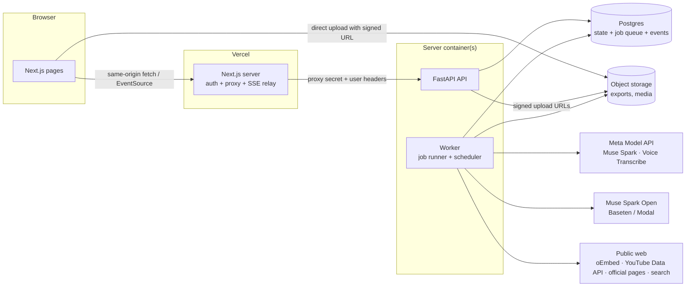
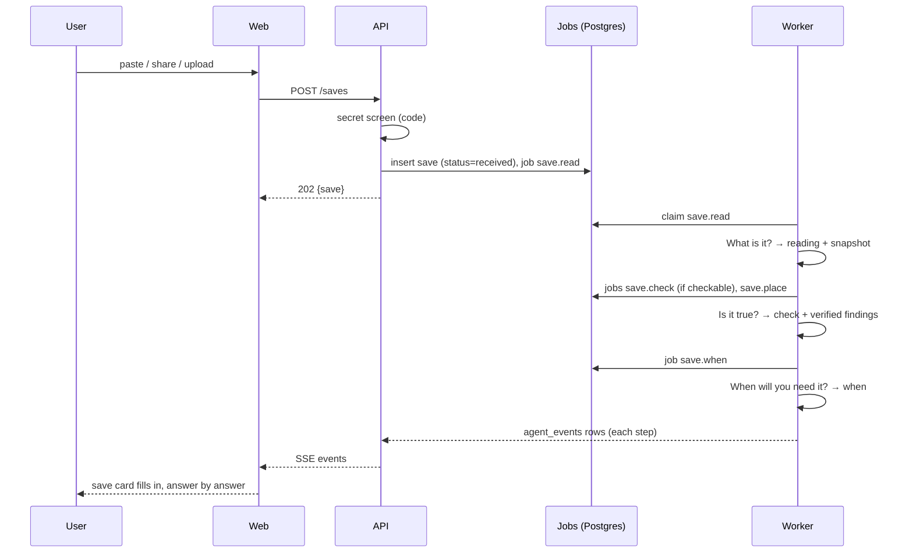

# 01 · Architecture

## Summary

Homing is made of three parts:

- **Web app (Next.js):** the screens, sign-in, and a server-side proxy to the API.
- **API (FastAPI):** fast endpoints that read and write state. Slow work never runs inside a request.
- **Worker (Python):** runs the four agents as jobs taken from a queue in Postgres, plus a scheduler for timed work.

Everything durable lives in **Postgres**. Uploaded files live in **object storage**. Meta's models are reached through one **model gateway**.

## Why this shape

| Choice | Reason |
|---|---|
| Next.js owns sign-in and proxies to the API | The browser never talks to the API directly. One shared secret protects the API. This worked in the current Crowscap, see [ADR 0005](adr/0005-auth-proxy.md). |
| Slow work runs only in the worker | Reading, checking and model calls take seconds to minutes. The API answers in milliseconds and returns `202 Accepted`. |
| Job queue in Postgres, not Redis | One less service to run and pay for. `SELECT … FOR UPDATE SKIP LOCKED` is enough at our scale. See [ADR 0002](adr/0002-postgres-job-queue.md). |
| Live updates by SSE over an events table | The team feed and Today update live. Every event is also stored, so a dropped connection resumes from the last event ID. |
| Direct-to-storage uploads | Vercel caps request bodies at about 4.5 MB, and WhatsApp exports with media can be hundreds of MB. |
| One model gateway | Caching, budgets, retries, concurrency limits and accounting live in one place. See [ADR 0006](adr/0006-model-gateway.md). |
| Hybrid search, Ask and Audit, no chat thread | Search combines words (Postgres full-text) and meaning (pgvector over embeddings from a small open model run in our worker). Ask gives one verified answer page per question; Audit runs as a job. See [ADR 0003](adr/0003-search-ask-audit.md). |

## Process types

| Process | Entry point | Runs |
|---|---|---|
| `web` | `web/` (Next.js) | Pages, NextAuth, `/api/backend/*` proxy, `/api/stream` SSE relay, `/share-target` |
| `api` | `server/app/main.py` (uvicorn) | REST endpoints and the SSE endpoint |
| `worker` | `server/app/worker.py` | Job runner threads plus the scheduler loop |

For local development or a single-container fallback, set `RUN_WORKER_IN_API=true` to start the worker loops inside the API process.

## Core flows

### 1. A new save (the "Now" path)

The save card shows each answer as soon as it exists. It never waits for all four.

### 2. Importing the WhatsApp pile (the "Past" path)

1. The browser asks for a signed upload URL and uploads the `.zip` or `.txt` directly to storage.
2. `POST /imports/whatsapp {storage_key}` creates the import and an `import.whatsapp` job.
3. The worker parses the export, creates the saves with their original timestamps, and screens secrets.
4. It enqueues `save.read` jobs at **low priority**, with small link saves grouped into batch reads.
5. When reading finishes, `user.rebuild_threads` runs one long-context pass to form threads.

### 3. Bringing things back (the "Later" path)

- Every 10 minutes, `tick.when` finds whens that are due or close, new saves landing in threads that have dates coming up, user moments, and saves that went bad.
- It creates candidate **cards**.
- At the user's morning (07:00 local, default) and on every tick, `user.today` keeps **at most 3 new cards per day**, picked by a code-computed priority.
- `card.prep` builds a prep sheet when a card needs one.

### 4. Search, Ask and Audit (anytime)

- **Search** (instant, in the API, no model call):
  - full-text and vector search run in one SQL round trip;
  - the results are merged with RRF;
  - private saves are never indexed.
- **Ask** (`POST /asks` → job `ask.answer`):
  1. Hybrid search, top 40, plus the saves in matching threads.
  2. Muse Spark picks the relevant saves.
  3. Load their snapshots.
  4. Spark writes points, each quoting a save.
  5. Code verifies every quote.
  6. The answer page fills in live over SSE.
- **Audit** (`POST /audits` → job `audit.run`): on a thread or the whole library. Code finds repeats and things that went bad. Long-context Spark proposes contradictions and gaps, and code verifies each contradiction's two quotes. The result is a report with one-tap actions.

### 5. Daily upkeep

| Job | What it does |
|---|---|
| `user.recheck_open` | Re-checks open opportunities. Deadline moved, closed, or link dead → event, plus a `went_bad` card if it matters. |
| `user.rebuild_threads` | Re-groups threads over the whole library. It proposes merges and splits, and never overrides the user's own edits. |

## Vocabulary

Use these names in code, the database, the API and the UI.

| Term | Meaning | Code name |
|---|---|---|
| Save | Anything the user adds | `save` |
| Save card | The four answers for one save | `SaveCard` (API view) |
| Reading | Answer to **What is it?** | `reading` |
| Check | Answer to **Is it true?** | `check` |
| Finding | One point inside a check, with its quote | `finding` |
| Thread | A goal saves serve (**What's it for?**) | `thread` |
| When | Answer to **When will you need it?** | `when` |
| Moment | Something the user says is coming ("recording Tuesday") | `moment` |
| Card | Something brought back to **Today** | `card` |
| Team event | One line in **The team** feed | `agent_event` |
| Snapshot | Our copy of a save's content at save time | `snapshot` |
| Embedding | Numbers capturing a save's meaning, used for search | `save_embedding` |
| Ask / answer page | One question, and its verified answer built from saves | `ask` |
| Audit / audit report | A check of a thread or the whole library | `audit` |

The agents are named after their questions:

| Agent ID | Question | Module |
|---|---|---|
| `what` | What is it? | `server/app/agents/what_is_it.py` |
| `true` | Is it true? | `server/app/agents/is_it_true.py` |
| `for` | What's it for? | `server/app/agents/whats_it_for.py` |
| `when` | When will you need it? | `server/app/agents/when_needed.py` |

## Status values (canonical)

| Thing | Values |
|---|---|
| Save `status` | `received` → `reading` → `ready` · `failed` |
| Save `visibility` | `normal` · `private` (secret-screened; never sent to a model) |
| Save `kind` | `note` · `link` · `image` · `pdf` · `voice` · `video` · `file` · `list` |
| Link `platform` | `youtube` · `x` · `instagram` · `facebook` · `tiktok` · `web` |
| Check `verdict` | `fits_you` · `closed` · `not_for_you` · `needs_your_answer` · `couldnt_confirm` · `nothing_to_check` · `checked` (not an opportunity: compared with its source, no fit verdict) |
| When `kind` | `date` · `moment` · `none` |
| Card `kind` | `deadline` · `prep` · `related` · `went_bad` · `answer_needed` |
| Card `state` | `new` · `used` · `dismissed` · `later` |
| Job `status` | `queued` · `running` · `done` · `failed` · `dead` |
| Ask / Audit `status` | `queued` · `working` · `ready` · `failed` |
| Audit item `kind` | `repeat` · `went_bad` · `contradiction` · `gap` · `let_go` |
| Audit item `state` | `open` · `done` · `ignored` |

## Design principles

These are the engineering side of PLAN §15.

1. **Proof or silence.** Any claim shown as fact carries a quote that code has found in the source. Code decides the labels; models only propose. See [05-verification.md](05-verification.md).
2. **Every slow thing is a job.** It's idempotent (dedupe keys), retryable (backoff) and observable (`agent_events`).
3. **Answers appear as they're ready.** The UI subscribes to events. Nothing blocks on the slowest agent.
4. **Privacy by routing.** Secret-looking content never reaches a model. Profile details go only to Muse Spark Open.
5. **Respect platforms.** No YouTube downloads, no Instagram or Facebook scraping, no WhatsApp bot. See [ADR 0008](adr/0008-platform-rules.md).
6. **Small modules.** No file over about 400 lines. The current Crowscap's 5,800-line chat service is the warning.

## Scale assumptions (hackathon)

- 1 to 50 users, up to about 2,000 saves each.
- Up to about 20 jobs a second at peak. One worker with 8 threads is enough.
- All numbers here are design targets, not measurements. Measure on Day 2.

## Folder layout

See [12-dev-workflow.md](12-dev-workflow.md#repository-layout).
