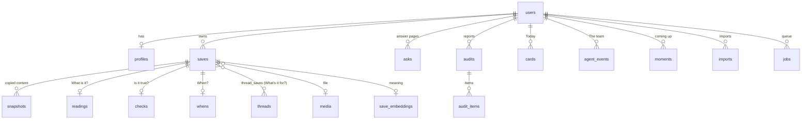

# 02 · Data model

Postgres 15+. SQLAlchemy 2.x models in `server/app/db/models/`, migrations with Alembic.

**Conventions:**
- **Keys and time:** IDs are UUIDv7, stored as text and made with `uuid7()`, so they sort by time. All timestamps are `timestamptz` in UTC.
- **Every user-owned table** has `user_id` and is queried through repository helpers that always filter by it. See [09-security-privacy.md](09-security-privacy.md#user-isolation).
- **JSON columns are typed.** Each `jsonb` column has a Pydantic model in `server/app/schemas/` and is validated on write.
- **Soft delete only where the product needs undo** (cards, threads). Saves are hard-deleted on user request, with their snapshots and media.



## Tables

### users
| Column | Type | Notes |
|---|---|---|
| id | text PK | |
| email | text unique | from Google, or `demo@crowscap.local` |
| name | text | |
| image_url | text null | |
| tz | text | IANA zone, default `Africa/Lagos` |
| is_demo | bool | demo user, reset nightly |
| created_at | timestamptz | |

### profiles

Used only by **Is it true?** for eligibility. Sent only to Muse Spark Open.

| Column | Type | Notes |
|---|---|---|
| user_id | text PK FK | |
| birth_year | int null | gives age "in the year you apply" |
| nationality | text[] | ISO 3166 alpha-2 |
| residence_country | text null | ISO alpha-2 |
| student_status | text null | `full_time` · `part_time` · `not_student` |
| education_level | text null | `secondary` · `undergraduate` · `postgraduate` · `graduate` |
| languages | jsonb | `[{"code":"en","level":"fluent"},{"code":"fr","level":"basic"}]` |
| company_stage | text null | `idea` · `pre_seed` · `seed` · `later` · `none` |
| company_registered | bool null | |
| updated_at | timestamptz | |

### saves
| Column | Type | Notes |
|---|---|---|
| id | text PK | |
| user_id | text FK | |
| kind | text | see [status values](01-architecture.md#status-values-canonical) |
| platform | text null | for links |
| origin | text | `paste` · `upload` · `share` · `import` |
| import_id | text null FK | |
| url | text null | as given |
| canonical_url | text null | normalized, see [04](04-ingestion.md#canonical-urls) |
| text | text null | the user's own text, or the message body |
| label | text null | short text the user typed next to a link |
| media_id | text null FK | |
| content_hash | text | sha256 of canonical_url, media sha256 or text, used for dedupe |
| saved_at | timestamptz | original message time for imports, otherwise now |
| status | text | `received` · `reading` · `ready` · `failed` |
| visibility | text | `normal` · `private` |
| private_reason | text null | e.g. `looks_like_code`. Never store the matched value. |
| duplicate_of | text null FK saves | set by **What's it for?** |
| error | text null | last failure, human-readable |
| created_at, updated_at | timestamptz | |

**Indexes:**
- `(user_id, saved_at desc)`
- `(user_id, content_hash)`, not unique, because the same link saved twice is a meaningful event
- partial `(status) where status in ('received','reading')`

### media
| Column | Type | Notes |
|---|---|---|
| id | text PK | |
| user_id | text FK | |
| storage_key | text | object storage path `u/{user_id}/{sha256}.{ext}` |
| mime | text | |
| bytes | bigint | |
| sha256 | text | |
| duration_s | numeric null | audio and video |
| original_filename | text null | |
| created_at | timestamptz | |

### snapshots

Our copy of the content at save time, so a dead link doesn't lose it.

| Column | Type | Notes |
|---|---|---|
| id | text PK | |
| save_id | text FK | |
| kind | text | `page_text` · `post_text` · `transcript` · `pdf_text` · `metadata` · `ocr_text` |
| source_url | text null | where it came from (may differ from the save URL) |
| text | text | normalized text, max 200k chars |
| meta | jsonb | e.g. YouTube `{title, channel, duration_s, chapters:[{t,title}]}` |
| fetched_at | timestamptz | |

### readings: "What is it?"
| Column | Type | Notes |
|---|---|---|
| save_id | text PK FK | |
| title | text | short, plain |
| what | text | one sentence: "A 12-minute talk on speaking techniques." |
| key_facts | jsonb | `KeyFacts`, see below |
| is_checkable | bool | has facts that can be wrong |
| is_opportunity | bool | |
| items | jsonb null | for `list` saves: `[{name, url?, note?}]` |
| model | text | |
| prompt_version | text | |
| created_at | timestamptz | |

`KeyFacts`:
```json
{
  "dates": [{"text": "closes TOMORROW", "role": "deadline"}],
  "amounts": [{"text": "$1,000 monthly stipend"}],
  "requirements": [{"text": "Aged 20–32"}],
  "links": ["https://apply.workable.com/afreximbank/"],
  "organisations": ["Afreximbank"],
  "places": ["Cairo"]
}
```

### checks: "Is it true?"
| Column | Type | Notes |
|---|---|---|
| save_id | text PK FK | |
| verdict | text | see status values |
| official_url | text null | |
| official_found_by | text null | `post_link` · `search` · `user` |
| deadline_at | timestamptz null | parsed by code, see [05](05-verification.md#dates-and-time-zones) |
| deadline_source_text | text null | the exact source words |
| deadline_tz_stated | bool | |
| findings | jsonb | `[Finding]` |
| eligibility | jsonb | `[EligibilityRule]` with results |
| question_for_user | text null | when the verdict is `needs_your_answer` |
| checked_at | timestamptz | |
| next_check_at | timestamptz null | daily while open |
| model | text | |
| prompt_version | text | |

`Finding`:
```json
{
  "point": "It's on-site in Cairo.",
  "quote": "Cairo, Cairo Governorate, Egypt",
  "kind": "left_out",
  "verified": true,
  "match": {"score": 100, "start": 1042, "end": 1073},
  "source_snapshot_id": "..."
}
```

`kind`: `left_out` · `differs` · `confirmed` · `closed` · `no_date`. Only findings with `verified: true` are ever shown.

`EligibilityRule`:
```json
{
  "rule": "age",
  "strength": "required",
  "params": {"min": 20, "max": 32, "reference": "year_of_application"},
  "quote": "aged between 20 and 32 in the year in which they apply",
  "verified": true,
  "result": "meets"
}
```

`result`: `meets` · `fails` · `unknown`.

### threads: "What's it for?"
| Column | Type | Notes |
|---|---|---|
| id | text PK | |
| user_id | text FK | |
| title | text | goal-shaped: "Getting into YC" |
| summary | text null | |
| created_by | text | `agent` · `user` |
| locked_by_user | bool | the user renamed or edited it, so agents may not rename or merge it |
| archived_at | timestamptz null | |
| created_at, updated_at | timestamptz | |

### thread_saves
| Column | Type | Notes |
|---|---|---|
| thread_id, save_id | PK | |
| added_by | text | `agent` · `user` |
| reason | text null | one line from the agent |
| created_at | timestamptz | |

### whens: "When will you need it?"
| Column | Type | Notes |
|---|---|---|
| save_id | text PK FK | |
| kind | text | `date` · `moment` · `none` |
| due_at | timestamptz null | for `date` |
| bring_back_at | timestamptz null | when to surface it, before due_at (see [03](03-agents.md#when-will-you-need-it)) |
| moment_id | text null FK | for `moment` |
| source | text | `reading` · `check` · `thread` · `user` |
| explanation | text | "Before the deadline on 15 Nov" |
| updated_at | timestamptz | |

Partial index: `(bring_back_at) where kind = 'date'`.

### moments
| Column | Type | Notes |
|---|---|---|
| id | text PK | |
| user_id | text FK | |
| text | text | "recording my demo" |
| at | timestamptz | |
| thread_ids | text[] | threads matched by **When will you need it?** |
| created_at | timestamptz | |

### cards: Today
| Column | Type | Notes |
|---|---|---|
| id | text PK | |
| user_id | text FK | |
| kind | text | `deadline` · `prep` · `related` · `went_bad` · `answer_needed` |
| save_id | text null FK | |
| thread_id | text null FK | |
| moment_id | text null FK | |
| title | text | |
| why_now | text | "Closes Sun 2 Nov, 23:59 Lagos time" |
| next_step | text | "Read the 3 differences, then decide" |
| payload | jsonb | e.g. `PrepSheet` |
| priority | int | computed by code |
| state | text | `new` · `used` · `dismissed` · `later` |
| surfaced_on | date null | the user-local date it entered Today |
| later_until | timestamptz null | |
| dedupe_key | text unique | e.g. `deadline:{save_id}:{due_date}` |
| created_at, updated_at | timestamptz | |

### agent_events: The team
| Column | Type | Notes |
|---|---|---|
| id | bigserial PK | monotonic, used as the SSE `Last-Event-ID` |
| user_id | text FK | |
| agent | text | `what` · `true` · `for` · `when` · `system` |
| action | text | e.g. `read`, `kept_private`, `checked`, `couldnt_confirm`, `placed`, `merged`, `when_set`, `surfaced`, `rechecked`, `went_bad` |
| summary | text | one plain sentence for the feed |
| save_id, thread_id, card_id | text null | |
| evidence | jsonb | `[{label, url?, snapshot_id?, quote?}]` |
| created_at | timestamptz | |

Index: `(user_id, id)`.

### agent_memory

Each agent's own memory, per user.

| Column | Type | Notes |
|---|---|---|
| user_id, agent, key | PK | e.g. (`u1`, `true`, `source:{canonical_url}`) |
| value | jsonb | |
| updated_at | timestamptz | |

What each agent remembers:
- **`true`:** official source per opportunity, and the last result.
- **`for`:** user corrections ("never put X in Y").
- **`when`:** dismissed cards, and surfacing fatigue per thread.

### jobs
| Column | Type | Notes |
|---|---|---|
| id | bigserial PK | |
| user_id | text null | |
| kind | text | see [03](03-agents.md#job-catalogue) |
| payload | jsonb | |
| priority | int | lower runs first: 10 user action · 50 normal · 90 import backlog |
| status | text | `queued` · `running` · `done` · `failed` · `dead` |
| attempts | int | |
| max_attempts | int | default 5 |
| run_after | timestamptz | |
| locked_by | text null | worker id |
| locked_at | timestamptz null | |
| dedupe_key | text null | unique where status in (`queued`,`running`) |
| last_error | text null | |
| created_at, updated_at | timestamptz | |

Index: `(status, priority, run_after) where status = 'queued'`.

### imports
| Column | Type | Notes |
|---|---|---|
| id | text PK | |
| user_id | text FK | |
| storage_key | text | |
| format | text | `android_txt` · `ios_txt` · `zip` |
| status | text | `received` · `parsing` · `done` · `failed` |
| counts | jsonb | `{messages, saves, media, private, duplicates, skipped}` |
| error | text null | |
| created_at, finished_at | timestamptz | |

### model_calls

Cache and accounting for model calls.

| Column | Type | Notes |
|---|---|---|
| id | bigserial PK | |
| user_id | text null | |
| purpose | text | e.g. `read.batch_links`, see [06](06-models.md#purposes) |
| model | text | |
| prompt_version | text | |
| input_hash | text | sha256 of (model, prompt_version, normalized input) |
| status | text | `ok` · `invalid_output` · `error` |
| tokens_in, tokens_out | int null | |
| cost_usd | numeric null | estimated |
| latency_ms | int | |
| output | jsonb null | validated output, reused on a cache hit |
| error | text null | |
| created_at | timestamptz | |

Index: `(input_hash) where status = 'ok'`.

### feedback

Grading for the accuracy numbers.

| Column | Type | Notes |
|---|---|---|
| id | text PK | |
| user_id | text FK | |
| target | text | `reading` · `check` · `thread` · `when` · `card` |
| target_id | text | |
| verdict | text | `right` · `wrong` · `nonsense` |
| note | text null | |
| created_at | timestamptz | |

### save_embeddings

Meaning-based search. Requires the `vector` extension (pgvector, built into Supabase).

| Column | Type | Notes |
|---|---|---|
| save_id | text PK FK | |
| user_id | text FK | denormalised so searches can filter by user without a join |
| model | text | e.g. `multilingual-e5-small` |
| embedding | vector(384) | of the reading text, see [06](06-models.md#embeddings-local) |
| text_hash | text | re-embed only when the reading changes |
| created_at | timestamptz | |

Index: `hnsw (embedding vector_cosine_ops)`. The query always filters `user_id = :u` first. Private saves never get a row.

### asks

One question, and its answer page.

| Column | Type | Notes |
|---|---|---|
| id | text PK | |
| user_id | text FK | |
| question | text | |
| follows_ask_id | text null FK | a follow-up carries the previous question as context |
| status | text | `queued` · `working` · `ready` · `failed` |
| answer | jsonb null | `Answer`, see below |
| candidate_save_ids | text[] | what hybrid search returned (kept for evals) |
| used_save_ids | text[] | what the answer cites |
| model, prompt_version | text | |
| created_at, finished_at | timestamptz | |

`Answer`:
```json
{
  "summary": "Your saves agree on three things: …",
  "points": [{"text": "Practise a one-minute answer to 'what are you building?'",
              "cites": [{"save_id": "…", "quote": "…", "verified": true, "t": null}]}],
  "disagreements": [{"text": "…", "cites": ["…", "…"]}],
  "out_of_date": [{"save_id": "…", "why": "The W27 deadline (2 Nov) has passed."}],
  "coming_up": [{"save_id": "…", "due_at": "…"}],
  "not_in_your_saves": "Nothing you saved covers the application form questions."
}
```

Only points with at least one verified citation are stored. `not_in_your_saves` is said plainly, and the gap is never filled from outside knowledge.

### audits
| Column | Type | Notes |
|---|---|---|
| id | text PK | |
| user_id | text FK | |
| scope | text | `thread` · `library` |
| thread_id | text null FK | |
| status | text | `queued` · `working` · `ready` · `failed` |
| counts | jsonb | per item kind |
| created_at, finished_at | timestamptz | |

### audit_items
| Column | Type | Notes |
|---|---|---|
| id | text PK | |
| audit_id | text FK | |
| kind | text | `repeat` · `went_bad` · `contradiction` · `gap` · `let_go` |
| save_ids | text[] | |
| summary | text | one plain sentence |
| evidence | jsonb | for `contradiction`: two verified quotes, one from each save |
| is_suggestion | bool | true for `gap` and `let_go` (model-proposed opinions) |
| action | text null | suggested action: `merge` · `archive` · `recheck` · `none` |
| state | text | `open` · `done` · `ignored` |

## Search

Two indexes, merged at query time (RRF, k = 60), in one SQL round trip. See [ADR 0003](adr/0003-search-ask-audit.md).

**Words:** a generated column on `readings`:

```sql
search_tsv tsvector GENERATED ALWAYS AS (
  setweight(to_tsvector('simple', coalesce(title,'')), 'A') ||
  setweight(to_tsvector('simple', coalesce(what,'')), 'B') ||
  setweight(to_tsvector('simple', coalesce(key_facts::text,'')), 'C')
) STORED
```

Also `pg_trgm` on `readings.title` and `saves.label` for typo-tolerant matching. Queries use `websearch_to_tsquery('simple', :q)`. We use `'simple'` rather than `'english'` because saves mix languages and names.

**Meaning:** the query is embedded with the same local model (using the `query:` prefix that e5 models expect), then ranked by `embedding <=> :qvec` on `save_embeddings` for that user.

**Merged score:** `score = Σ 1 / (60 + rank_i)` over both lists. Top results are returned with highlights from the word match where one exists.

## Migrations

- One Alembic migration per change. Never edit a migration once it's applied.
- `alembic upgrade head` runs on every deploy before the API starts. See [10](10-deployment-ops.md#deploy-steps).
- Demo data comes from `python -m app.scripts.seed_demo`, not from migrations.
