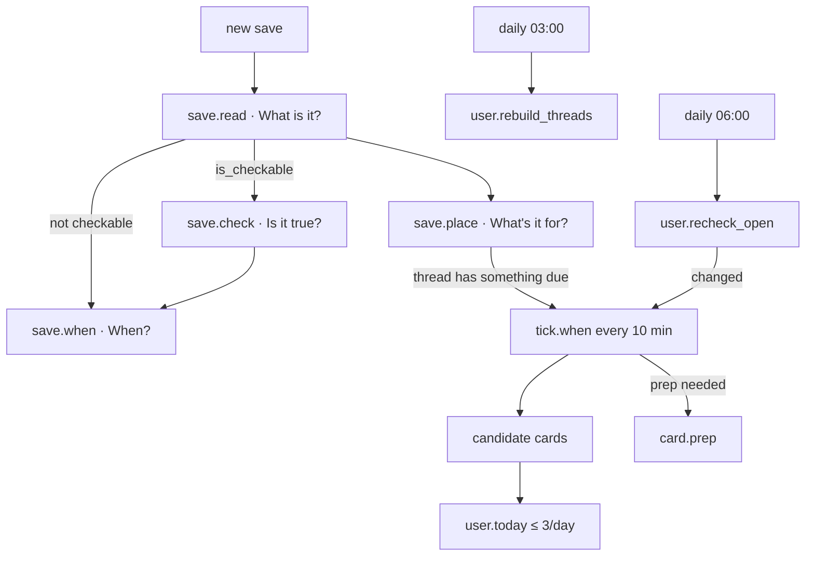

# 03 · Agents

Four agents, one per question. They run in the **worker**, as jobs.

**What every agent has:**
- its own memory (`agent_memory`);
- its own log (`agent_events`), where every entry carries evidence;
- a clear list of things it must **never** do.

**How they relate to models:** agents *use* models through the [model gateway](06-models.md), but code makes the final call on anything shown as fact. See [05-verification.md](05-verification.md).

## The agent contract

Every agent module exposes job handlers with this shape:

```python
class JobContext(Protocol):
    db: Session                 # scoped to this job
    user: User
    models: ModelGateway        # cached, budgeted
    fetch: SafeFetcher          # SSRF-safe HTTP
    storage: Storage
    memory: AgentMemory         # get/set for this agent + user
    emit: EventEmitter          # writes agent_events rows

def handle_save_read(ctx: JobContext, payload: SaveReadPayload) -> None: ...
```

**Handler rules:**
1. **Idempotent:** running twice gives the same result. Upsert by `save_id`, use dedupe keys.
2. **Fail loudly, retry safely.** Raise `RetryableError` for timeouts, 429s and 5xx (the runner backs off). Raise `PermanentError` for bad input (the job is marked `failed`, the save gets `error`, and an event explains it in plain words).
3. **Emit as you go:** at least one `agent_event` per meaningful step, with evidence.
4. **Never block on another agent.** Enqueue the next job and return.

## Job catalogue

| Kind | Enqueued by | Handler | Priority | Dedupe key |
|---|---|---|---|---|
| `import.whatsapp` | API `POST /imports/whatsapp` | `ingest.whatsapp.importer.import_whatsapp` | 10 | `import:{import_id}` |
| `save.read` | API on new save; import | `what_is_it.read_one` | 10 user / 90 import | `read:{save_id}` |
| | **Lanes (1 Nov):** every job carries `lane` (`JOB_LANE`, "main" in production, "dev" on a laptop). Workers take and requeue only their own lane's jobs, because development and production share the database and an upload exists only on the machine that received it. | | | |
| `save.read_batch` | import (small link saves) | `what_is_it.read_batch` | 90 | `readb:{hash of ids}` |
| | **As built (1 Nov):** the importer queues its notes, links and lists 20 to a job (`readb:{first save id}`). Each save is opened as usual; one with nothing to read is kept without a model; one with more than 2,000 characters gets its own `read.text`; the rest share one `read.batch` call. Code keeps only facts found in each save's own words, so saves read together can't borrow from each other. A save the model skips, or a batch that keeps failing, falls back to `save.read`. | | | |
| `save.check` | after read, if `is_checkable` | `is_it_true.check` | 20 | `check:{save_id}` |
| `save.place` | after read | `whats_it_for.place` | 30 | `place:{save_id}` |
| `save.when` | after check (or after read if not checkable) | `when_needed.set_when` | 30 | `when:{save_id}` |
| `moment.match` | API `POST /moments` | `today.match_moment` | 10 | `moment:{moment_id}` |
| `card.prep` | `tick.when` when a prep card is needed | `when_needed.build_prep` | 20 | `prep:{card_id}` |
| `user.rebuild_threads` | after import; daily 03:00 user time | `whats_it_for.rebuild` | 60 | `rebuild:{user_id}:{date}` |
| `user.recheck_open` | daily 06:00 user time | `is_it_true.recheck_open` | 60 | `recheck:{user_id}:{date}` |
| `user.today` | daily 07:00 user time; after each tick | `when_needed.compose_today` | 40 | `today:{user_id}:{date}:{hour}` |
| `tick.when` | scheduler every 10 min | `when_needed.tick` | 40 | `tick:{yyyymmddhhmm}` |
| | **As built (S11, 2 Nov):** neither `user.today` nor `tick.when` runs. Today is composed by code when it's opened ([below](#when-will-you-need-it)). | | | |
| `system.echo` | `POST /dev/echo` (local only), tests | `jobs.handlers.system_echo` | 10 | none |
| `save.embed` | after read (non-private only) | `search.embed.embed_save` | 30 | `embed:{save_id}:{text_hash}` |
| `ask.answer` | API `POST /asks` | `ask.answer` | 10 | `ask:{ask_id}` |
| `audit.run` | API `POST /audits` | `audit.run` | 20 | `audit:{audit_id}` |

**Runner behaviour** (`server/app/jobs/runner.py`):
- **Claiming:** `SELECT … WHERE status='queued' AND run_after<=now() ORDER BY priority, id FOR UPDATE SKIP LOCKED LIMIT 1`.
- **Threads:** `WORKER_THREADS` (default 3). Each thread holds a database connection while it works, and Supabase's free tier allows only a few, so keep it below `DB_POOL_SIZE`. Idle threads check for work every 0.5s.
- **Backoff:** `run_after = now() + min(2^attempts × 10s, 30 min)`. After `max_attempts`, the job is marked `dead` and a system event is emitted.
- **Stuck jobs:** a job in `running` longer than 15 minutes goes back to `queued` (the worker probably crashed).
- **Scheduler** (`server/app/jobs/scheduler.py`): one loop, wakes every 60s, and enqueues timed jobs using dedupe keys, so running two schedulers is harmless.

---

## What is it?

`server/app/agents/what_is_it.py` · agent ID `what`

**Job:** read every save, keep a copy of its content, and write down what it is and its key facts.

**Triggers:** `save.read`, `save.read_batch`.

**Steps:**
1. **Screen:** if `visibility = private`, write a minimal reading ("Kept private: looks like a code") without calling any model. Done.
2. **Gather content** with the connector for the save's kind or platform (see [04-ingestion.md](04-ingestion.md)). Store a `snapshot`.
3. **Read** with Muse Spark using the right purpose:

   | Save | Purpose | Model input |
   |---|---|---|
   | short link with oEmbed/metadata only | `read.batch_links` (up to 20 per call) | text |
   | note, web page, X post | `read.text` | text (snapshot, truncated to 12k tokens) |
   | image or flyer | `read.image` | image URL (signed) |
   | PDF | `read.pdf` | PDF (signed URL or file), or text if it has a text layer |
   | voice note | transcribe first (`transcribe.voice`), then `read.text` | audio, then text |
   | video file | `read.video` | video (signed URL or file) **(confirm)** |
   | list (one message with many links) | `read.list` | text, and returns `items` |

4. **Validate** the output with Pydantic (`Reading` schema) and save it.
5. **Hand over:**
   - If `is_checkable` → enqueue `save.check`. Otherwise → enqueue `save.when`.
   - Always enqueue `save.place`, and `save.embed` (for non-private saves, so the save becomes searchable by meaning).
6. **Emit** `read`, for example *"Read a flyer: Afreximbank internship call (Cairo)."* with evidence = the snapshot.

**Output schema** (`schemas/agents.py`):
```python
class Reading(BaseModel):
    title: str            # ≤ 80 chars, plain
    what: str             # one sentence, ≤ 160 chars
    key_facts: KeyFacts
    is_checkable: bool    # has dates, requirements, prices, or claims about an outside thing
    is_opportunity: bool  # grant, programme, job-like, competition, scholarship, accelerator, hackathon
    items: list[ListItem] | None = None
```

**Never:**
- calls a model on `private` saves;
- invents content it couldn't read. Unreadable Instagram/Facebook links get `what = "Instagram reel (we can't see inside it)"` and `is_checkable = false`;
- edits `saves.text`, `saves.url` or `saves.label`.

**Memory:** none needed. Readings are the record.

---

## Is it true?

`server/app/agents/is_it_true.py` · agent ID `true`

**Job:** for saves with checkable facts, compare the save with its official source, then label it for this user. Every point it shows must be quoted from the source and verified by code.

**Triggers:** `save.check`, `user.recheck_open`.

**Steps:**
1. **Find the official source.** The order is in [05 · Finding the official source](05-verification.md#finding-the-official-source):
   - links in the content;
   - then the agent's memory, for an opportunity it has seen before;
   - then a search.

   Record `official_found_by`.
2. **Fetch** with `SafeFetcher` and store a `snapshot` (`page_text` or `pdf_text`). If it's blocked or empty → verdict `couldnt_confirm`, emit an event, stop.
3. **Compare** with Muse Spark (`check.compare`). The input is the save's reading and text plus the official snapshot. The output is proposed `findings` (each with a `quote` from the official text), proposed `eligibility` rules (each with a `quote`), and the proposed deadline text.
4. **Verify by code** ([05](05-verification.md)):
   - each quote is matched against the snapshot, and findings that fail are dropped;
   - the deadline is parsed from the quoted source text;
   - "closed" signals are detected.
5. **Eligibility:** structured rules are compared with `profiles` by code. Only free-text rules that code can't judge (e.g. "relevant discipline") go to **Muse Spark Open** (`check.eligibility_open`), which answers `meets` / `fails` / `unknown` with a reason. `unknown` becomes a question for the user.

   **As built (S6):**
   - Spark Open isn't on our key, so a free-text rule becomes a yes/no question the model phrases (`question`, `yes_meets`), answered on the card.
   - Questions are asked only for required rules that are still unknown, one per missing fact (birth year, a language's level, …).
   - Each answer is remembered on the profile (or on the check, for one-off rules). Every saved opportunity is then re-judged by code, with no model call, and The team gets one line: "Used your answer on 2 saved opportunities: 2 aren't for you."
   - Saves that aren't opportunities get `checked`, never a fit verdict.
   - Opportunities are always checked, even when saved as a bare link.
   - **No official page, or the link goes to a different page:** the rules are taken from the post's own words (quotes checked against the post), and the card says so. With no official page, a closing date the post itself gives that has passed makes it `closed`. An opened official page always wins over the post.
   - **List items** (1 Nov): an item with no link has its own site found by search (`found_by: "search"`). Whether an item is an opportunity is decided by its own page: who-can-apply rules or a closing date make it one, so a directory or a news page is just `checked`. Rules only the person can judge ("Are you building in Africa?") don't block an item's verdict; the card lists them under "Check yourself". `note` keeps what the post said about the item, and `problem` says why it couldn't be checked.
   - **Lists (S7):** a save whose reading has 2+ `items` fans out to one `save.check_item` job per item (up to 20). Each item's page is fetched and compared, and its rules and verdict are judged by code. Several items write to the same check under a row lock. The team gets one line per item ("Checked TripleFunds on triple-funds.com: it fits you.").
6. **Verdict by code** (never by a model):
   1. if the page says closed, or `deadline_at < now` → `closed`;
   2. else if any `required` rule `fails` → `not_for_you`;
   3. else if any `required` rule is `unknown` → `needs_your_answer`, with `question_for_user` set;
   4. else if no official source was opened → `couldnt_confirm`;
   5. else → `fits_you`.
7. Save the `check`. Set `next_check_at` to tomorrow 06:00 user time if the opportunity is still open. Enqueue `save.when`.
8. **Emit** `checked`, for example *"Checked against apply.workable.com: 4 things the post left out."* with evidence = verified findings.

**Re-check** (`user.recheck_open`): re-fetch the official sources of open items, re-run steps 2–6, and diff against the last check. If the deadline moved, the item closed, or the link is dead → emit `rechecked` or `went_bad`, and propose a `went_bad` card.

**Lists:** for `kind = list`, check each item, up to 20, as a child check stored in `findings` under `items[i]`. The save gets a summary verdict: counts per verdict.

**Never:**
- shows an unverified point;
- fills a gap with the model's knowledge;
- sends profile data to the closed model;
- fetches pages that robots.txt disallows, or private IPs.

**Memory:**
- `source:{canonical_url}` → `{official_url, found_by, last_checked_at, last_verdict}`, so a repeat of the same opportunity reuses its source.

---

## What's it for?

`server/app/agents/whats_it_for.py` · agent ID `for`

**Job:** connect saves to the goals they serve (threads), and spot repeats.

**Triggers:** `save.place` (each save), `user.rebuild_threads` (whole library).

**Place one save:**
1. **Duplicates (code):** look for the same `content_hash` → set `duplicate_of`, emit `merged` (*"You saved this before, on 8 Jul."*).
2. **Assign (model, `place.assign`):** the input is the reading plus the current thread titles and summaries (≤ 60 threads). The output is `{thread_id | new_thread_title, reason}`.
3. **Respect the user:**
   - never add a save to a thread the user removed it from;
   - never rename a `locked_by_user` thread.
4. **Hand over:** if the save joins a thread that has a dated save coming up, enqueue `tick.when`.
5. **Emit** `placed`, for example *"Added to 'Getting into YC' (8th save)."*

**Rebuild** (long context, `place.rebuild`):
- **Input:** compact lines for every `ready` save, `id | saved_at | title | what | label`. About 624 saves is about 40k tokens, well inside 1M.
- **Output:** a proposed set of threads with membership, merges and splits.
- **Apply by code:** create and merge only where it doesn't conflict with user edits. Emit one `rebuilt` event with counts.
- Threads are **goals**, phrased as such ("Getting into YC", "Speaking better"). The prompt forbids traits and personality labels. Output with person-describing titles is rejected by a validator (word list plus pattern) and retried once.

**Rebuild, as built (S9, 1 Nov):** job `threads.rebuild`, queued by an import when it finishes (it waits, without using attempts, while the import's saves are still being read; after 3 hours it goes with what's ready) or by the person (`POST /threads/rebuild`, "Organise my saves"). Imported saves no longer get `save.place` one by one.
- **Repeats first, by code** (`link_repeats`): a later save with the same `content_hash` gets `duplicate_of` and a `merged` event; after placing, repeats join their original's threads.
- **Only saves with something to go on are sent:** a model reading or the person's own words. "An Instagram post you saved" with no words isn't.
- **One long-context call** (`place.rebuild`): numbered lines plus the existing threads (T1, T2…, `locked` when the person named them).
- **Code checks the plan:** real line numbers only; titles through `clean_title` (never about the person); a new goal needs 2 saves, an existing one can take 1; at most 2 goals a save; a locked thread keeps its name. Agent memberships of unlocked threads are replaced; the person's own are kept; threads left empty are archived, never deleted.
- **A second look:** one long answer under-places, so when 10 or more saves were left out, the agent gets only those plus the goals it made (`note`: second look), and adds what clearly fits.
- **Measured on Isreal's pile (605 saves, 405 with something to go on):** first pass alone placed 224 (55%) into 20 goals for 25,150 tokens; with the second look, 340 (84%) into 24 goals for 42,560 tokens, against about 900,000 for placing one by one. The 65 left out were jokes, greetings, booking links and unreadable videos. Goals include "Starting and scaling startups" (64), "Learning Agentic AI" (33), "Finding funding and grants" (27), "Improving communication skills" (12), "Getting into YC" (8). 15 repeats linked.

**Never:**
- labels the user as a person;
- deletes a save;
- overrides a user edit.

**Memory:**
- `rule:{n}` → user corrections such as "keep faith content out of threads";
- `last_rebuild_at`.

---

## When will you need it?

`server/app/agents/when_needed.py` · agent ID `when`

**Job:** give every save a "when" at save time, then bring saves back at that moment with the next step, without overwhelming the user.

**Triggers:** `save.when`, `moment.match`, `tick.when`, `user.today`, `card.prep`.

**Set the "when"** (`save.when`), in priority order:
1. `check.deadline_at` (verified) → `kind = date`, `due_at = deadline`.
2. A dated fact in the reading (`key_facts.dates` with role `deadline`/`event`), parsed by code relative to `saved_at` → `kind = date`.
3. A date from a thread: the save belongs to a thread that has a dated save coming up → `kind = date`, `source = thread`.
4. A matching user moment → `kind = moment`.
5. Otherwise → `kind = none`, explained as *"No date. It'll come back when you save something related or search for it."*

`bring_back_at` (code):

| Lead time | Bring back |
|---|---|
| Due in > 7 days | 7 days before |
| Due in 2–7 days | 2 days before |
| Due in < 48h | now |

Always at 09:00 user time, unless that time has already passed.

Emit `when_set`, for example *"Will bring this back on Sun 2 Nov, 09:00 Lagos time."*

**Moments** (`moment.match`): the user types "recording my demo on Tuesday". Code parses the date. The model (`when.match_moment`) picks the related threads from the titles. Store `thread_ids`, then create a `prep` card candidate for `at − 1 day`.

**Tick** (`tick.when`, every 10 min), creates **candidate** cards with dedupe keys:

| Kind | When |
|---|---|
| `deadline` | `bring_back_at <= now`, check verdict in (`fits_you`, `needs_your_answer`), not yet closed |
| `prep` | a moment or dated event is ≤ 36h away and its threads hold ≥ 3 saves |
| `related` | a new save landed in a thread with something due within 7 days |
| `went_bad` | a re-check found closed, moved or dead **and** the save had a "when" |
| `answer_needed` | a check is `needs_your_answer` and is due within 7 days |

**Compose Today** (`user.today`), by code. The model isn't used.

```
priority = urgency + importance − fatigue
urgency    = 100 if due < 24h, 70 if < 72h, 40 if < 7d, else 10
importance = +20 opportunity, +15 prep, +10 thread has ≥ 5 saves
fatigue    = 15 × dismissals in this thread over the last 14 days
```

- At most **3** cards with `state = new` and `surfaced_on = today`.
- `later` cards come back when `later_until` passes.
- Each new card emits `surfaced`.

**As built (S11, 2 Nov)** (`server/app/agents/today.py`):
- **Today is composed when it's opened** (`GET /today`), not by `tick.when` and `user.today`. There's no push, so a timer would add nothing the person sees, and composing on open means Today is never stale. The tick comes back if push notifications do.
- **Candidates:** `deadline` (a dated save whose `bring_back_at` has passed and that isn't closed or not for you; saves never checked count too) and `prep` (a moment ≤ 36h away whose goals hold ≥ 3 saves). `related`, `went_bad` and `answer_needed` aren't built.
- **Cards are rows** (`cards`, migration 0008) with a `dedupe_key` (`deadline:{save_id}:{due date}`, `prep:{moment_id}`), so opening Today twice makes no new card. States: `new`, `used`, `dismissed`, `later`, `gone`. A `new` card whose save no longer qualifies (closed, not for you, date passed) becomes `gone`.
- **Three a day means three surfaced a day:** the cap counts cards with `surfaced_on = today`, so dismissing one doesn't open a slot. A card stays on Today until it's acted on or no longer needed, and Today never shows more than 3 at once (fixed 2 Nov: a card first showed only on the day it came in, so a prep card for Tuesday evening would have gone on Tuesday morning).
- **Dismissed never comes back:** by its save or its moment, read from `cards` (not `agent_memory`). Each dismissal also adds fatigue to that card's goals for 14 days.
- **Later** brings a card back at 09:00 the next morning, user time.
- **The next step is decided by code** from the check: "Answer 4 questions to see if it fits you.", "It fits you. Apply before it closes.", "Read the 2 things the post left out, then decide.", or "Decide whether to apply before it closes."
- **Moments:** code reads the day and time from the person's words (`verify/dates.parse_moment`): a date, a weekday (the next one), "tomorrow", "today" or "tonight", and a clock time or a part of the day (morning 09:00, evening 18:00, night 20:00). Nothing said → 09:00. No day, or an unclear one like "11/12" → the API asks them to say when. `moment.match` then gives Spark the person's goal titles (the 60 largest, as `T1…`) and code keeps only real ones, 3 at most. The team gets, e.g., "Noted: recording my demo, Tue 3 Nov, 18:00 Lagos time. 16 saves in 'Making a demo video' can help."
- **A closed call with a date ahead** (2 Nov, the Meta hackathon page: applications closed 25 Oct, submissions due 4 Nov): the "when" is the next date on the page, explained as "Applications closed on Mon 26 Oct, 04:59. Next on the page: Thu 5 Nov, 03:00 Lagos time." Today keeps a closed save only while it has a date ahead, with the next step "Applications are closed. If you're in, this is your next date."
- **Calendar:** `GET /saves/{id}/calendar.ics`, the date with a reminder a day before.
- The prep sheet (`card.prep`) is S12: until then a prep card names the goals and how many saves can help.

**Build a prep sheet** (`card.prep`):
1. **Collect** the thread's saves. Videos come first, then notes and PDFs.
2. **Understand each video** with `VideoUnderstanding` (see [06](06-models.md#video-understanding)). It returns `points[{text, t_start, t_end}]`.
   - Code checks `0 ≤ t_start < t_end ≤ duration_s`, and drops failures.
3. **Synthesise** (`prep.sheet`): agreements, disagreements, and a 5-point list, each citing `(save_id, t_start)` from step 2 only.
   - Code rejects any citation that wasn't produced in step 2.
4. **Reel:** take the top segments, padded −3s/+12s, merged when they overlap, total ≤ 180s.
5. **Store** it as `card.payload` (`PrepSheet`).

**As built (S12, 2 Nov)** (`agents/prep.py`, `prepare`):
- **Queued** when a prep card enters Today, or when its page is opened without a sheet. The sheet's status (`queued`, `working`, `ready`, `failed`) lives in `card.payload.sheet`; Today merges payloads, so a refresh never wipes it.
- **Which videos:** saves in the moment's goals with timed captions, ranked by meaning against the moment (code, the saved embeddings), each goal taking its turn so one big goal can't crowd out the others; 8 at most.
- **Captions come from the save,** never fetched at prep time: the server can't reach YouTube. `scripts/fetch_captions.py` stores them for a pile imported on the server, from a home connection, with no model.
- Each video's points and the sheet are checked as above. The team gets one line per video ("Went through '3-2-1 speaking trick video' for recording my demo video…: 6 points, each found in the captions at its second.") and one when it's ready.
- **Reel:** cited points, checklist first, −3s/+12s, merged where they touch, ≤ 180s; it plays in the app one clip after another.
- Reels (Instagram, TikTok, Facebook) and videos without captions are counted and named on the sheet, not guessed at.
- On Isreal's demo moment: 8 videos from both goals, all used, 1 point dropped, 5 steps, 6 agreements, 1 disagreement (generate the voice or record it live), a 2:59 reel; about 120s and two model steps.

**Never:**
- shows more than 3 new cards a day;
- brings back what the user dismissed (`agent_memory: dismissed:{save_id}`);
- invents a deadline. Dates come from verified source text or the user.

---

## Ask and Audit (on request)

These aren't extra agents. They're jobs that use what the four agents have already produced (readings, snapshots, checks, threads and whens), so every source has already been understood and screened. Their work shows up in **The team** as `system` events, listing which saves each step used.

### Ask

`server/app/ask/answer.py`. One question gives one answer page.

1. **Candidates (code):**
   - hybrid search ([02 · Search](02-data-model.md#search)), top 40;
   - plus every save in the top 2 matching threads;
   - plus, for a follow-up, the previous ask's `used_save_ids`.

   Deduplicated, capped at 80, private saves excluded.
2. **Pick (model, `ask.select`):** Spark sees one compact line per candidate (`id | title | what | label | thread | saved_at | verdict`) and returns the IDs that bear on the question, with a one-line reason each.
3. **Load:** the snapshots of the picked saves (truncated per save so the total stays ≤ 60k tokens), plus their checks and whens.
4. **Answer (model, `ask.answer`):** points, disagreements, out-of-date items and things coming up. **Every point cites at least one save with an exact quote from that save's snapshot or reading.** If the saves don't cover something, it goes in `not_in_your_saves`. The model must not use outside knowledge.
5. **Verify (code):**
   - every quote is matched against the cited save's snapshot or reading ([05 · Answers and audits](05-verification.md#answers-and-audits));
   - points with no verified citation are dropped;
   - video citations are checked as timestamps;
   - "out of date" items must come from a check verdict or a past `due_at`, never from the model alone.
6. **Save** `asks.answer`, and emit `save_updated`-style SSE events (`ask_ready`).

**Never:** answers from outside the user's saves; cites a private save; keeps a point it can't verify.

**As built (3 Nov): Muse Wonder runs Ask as an agent** (`search/ask_agent.py`). Wonder picks its own steps with three tools: `search_saves(query)` (hybrid search, 8 results, short ids S1, S2…), `open_save(S3)` (the save's own text; under 300 characters it says to list it in `also`), and `submit_answer(points, not_covered, also)`. Submitting is the gate it can't skip: code checks that each point's save was opened, that its quote is in that text word for word, and that its numbers are in its quote; a refused answer comes back with the problems named. At most 10 turns and 3 refusals; then only verified points are kept. Every search, open and refusal is a step in Your agents (credited to Muse Wonder; refusals to code). If Wonder errors, the Spark pipeline above answers and the answer says which ran. First real run (demo pile, "funding without giving up equity"): 6 searches in its own words, 6 saves opened, 4 points, every quote found, 0 refused, 52 s; it also said which grants' equity terms the saves don't confirm.

### Audit

`server/app/audit/run.py`. Scope: one thread, or the whole library.

| Item | Found by | Rule |
|---|---|---|
| `repeat` | code | same `content_hash`, or embedding similarity ≥ 0.95 with the same platform and title |
| `went_bad` | code | check verdict `closed`, dead link, or a past `due_at` that's still marked open |
| `contradiction` | model (`audit.contradictions`, long context over the scope's readings and snapshots), then code | needs two quotes, one from each save, both verified. Otherwise dropped. |
| `gap` | model (`audit.gaps`) | marked `is_suggestion = true`, and shown as "You might be missing…" |
| `let_go` | code | not in any thread, never brought back, older than 6 months, never opened |

Each item gets a suggested action (`merge` · `archive` · `recheck` · `none`). The user acts with one tap. "Archive" hides a save from Today and search; it never deletes.

**Never:** deletes anything; presents a gap or let-go suggestion as fact; audits private saves' content (they're only counted).

## Orchestration at a glance



## Why four agents, not one script

- **They run at different times:** on each save, daily, at dates, and at moments.
- **Each one is accountable:** every event names the question it answered.
- **Failures are contained:** a failed check doesn't block reading or placing.
- **Each has its own memory and its own "never" list,** so behaviour stays predictable.
